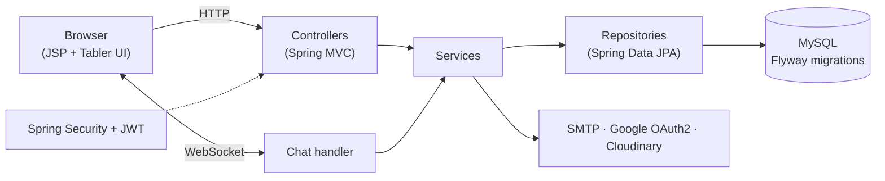

<div align="center">

# QAUTE — Student Advisory Portal

**An online advisory platform for students of Ho Chi Minh City University of Technology and Education (HCMUTE).**

*Hệ thống tư vấn trực tuyến dành cho sinh viên Trường Đại học Công nghệ Kỹ thuật TP.HCM (HCMUTE).*

FAQ knowledge base · Ticketing · Real-time chat · Appointment booking

[English](#english) · [Tiếng Việt](#tiếng-việt)

</div>

---

# English

## 1. Overview

QAUTE connects students with university advisors (called **Managers**). Instead of visiting several departments or waiting on emails, students can:

- search a public **FAQ** knowledge base for common questions (regulations, credit registration, tuition, major-specific topics);
- submit support **tickets** with attachments and track their status;
- **chat in real time** with an advisor;
- **book appointments** based on each advisor's availability.

Managers and Admins get tools to route requests by department, enforce SLAs, review FAQ content, audit activity and export reports.

## 2. Features

The system has four roles: **Guest**, **Student**, **Manager** and **Admin**.

### 2.1. Guest (not signed in)
- Browse the FAQ category tree; search by keyword and filter by category or tag
- Read public announcements
- Sign in with email / student ID or Google OAuth2; reset password via an emailed OTP

### 2.2. Student
- Personal dashboard with tickets, chats, appointments and notifications
- FAQ: bookmarks, helpful / not helpful ratings, recently viewed, search history, suggest new FAQs
- Tickets: choose department and priority, attach files (up to 10 MB), track status and history, reply
- Real-time chat with advisors, file sharing, 1–5 star rating, convert a chat into a ticket
- Appointments: pick an advisor and a free slot, reschedule or cancel, download an `.ics` file, reminders
- Notification center with per-type preferences; profile, avatar and session management

### 2.3. Manager (advisor, limited to an assigned scope)
- Ticket queue filtered by category, priority, status and age; claim, reply, transfer, add internal notes, mark urgent, close
- Chat desk with a capacity limit, transfer and end-session controls
- FAQ authoring with an approval workflow; convert a ticket into an FAQ
- Working-hours rules, slot generation, blocked time; accept, complete or cancel appointments, mark no-shows
- Student profile view (ticket, chat and appointment history) with access checks
- Canned replies with dynamic variables; personal performance report exported to CSV

### 2.4. Admin
- System-wide dashboard and statistics
- User management: create, lock, demote, invitation emails, CSV import / export, Manager scope assignment
- FAQ approval, versioning and CSV import / export; ticket oversight and intervention
- Department and category trees; SLA configuration and breach tracking
- Tags and synonyms to improve search; public announcements (sanitized HTML)
- Audit log, health check, site settings, media management, reports exported to CSV

## 3. Technical Highlights

- **Layered architecture:** controller → service → repository, with DTOs separated from JPA entities.
- **Security:** Spring Security with JWT, Google OAuth2, role-based access control, hashed passwords, and scope-based access for Managers.
- **Real-time chat** over WebSocket.
- **Versioned database schema** managed with Flyway migrations.
- **Input safety and abuse protection:** OWASP Java HTML Sanitizer for rich text, Apache Tika for uploaded content, Bucket4j for rate limiting.
- **Operations:** configurable SLAs, an audit trail for sensitive actions and an admin health check (database, email, services).
- **Environment profiles:** `dev`, `demo` (seed data and demo accounts) and `google` (OAuth2).

## 4. Architecture



```text
qaute/
├── pom.xml
├── mvnw, mvnw.cmd                  # Maven Wrapper
├── src/main/java/.../qaute/
│   ├── config/                     # App, WebSocket and Cloudinary configuration
│   ├── controller/                 # Page and workflow controllers
│   ├── dto/                        # Data transfer objects
│   ├── entity/                     # JPA entities
│   ├── repository/                 # Data access
│   ├── security/                   # Authentication, authorization, JWT
│   ├── service/                    # Business logic
│   └── websocket/                  # Real-time chat
├── src/main/resources/
│   ├── application*.properties     # Per-environment configuration
│   ├── db/migration/               # Flyway migrations
│   ├── mail-templates/             # Email templates
│   └── static/                     # CSS, JavaScript, images
└── src/main/webapp/WEB-INF/
    ├── decorators/                 # SiteMesh layouts per user group
    ├── tags/                       # Shared JSP tags
    └── views/                      # JSP pages
```

## 5. Tech Stack

| Area | Technologies |
|---|---|
| Language & build | Java 25, Spring Boot 3.5, Maven |
| Web | Spring MVC, JSP, JSTL, Apache Tomcat, SiteMesh |
| UI | Tabler (Bootstrap), Bootstrap Icons, vanilla CSS and JavaScript |
| Database | MySQL, Spring Data JPA / Hibernate, Flyway |
| Security | Spring Security, JWT, Google OAuth2 |
| Real-time | WebSocket |
| Integrations | Spring Boot Mail (SMTP), Cloudinary |
| Utilities | Lombok, Apache Tika, OWASP Java HTML Sanitizer, Bucket4j |

## 6. Getting Started

### 6.1. Prerequisites

- JDK 25
- MySQL Server (running)
- Maven 3.9+ (optional — the Maven Wrapper is included)
- Internet access if you use Google OAuth2, SMTP or Cloudinary

### 6.2. Clone

```bash
git clone https://github.com/thanhtoan06/QAUTE-Student-Advisory-Portal.git
cd QAUTE-Student-Advisory-Portal
```

### 6.3. Configure

Make sure your MySQL account can create or use the `qaute` database. If the default connection settings do not fit your machine, override them in `src/main/resources/application-local.properties`.

> Add `application-local.properties` to `.gitignore` before putting any secrets in it. Never commit passwords, JWT keys, SMTP, OAuth2 or Cloudinary credentials.

| Property | Purpose |
|---|---|
| `spring.datasource.url` | MySQL connection URL (add `createDatabaseIfNotExist=true` to auto-create the `qaute` database) |
| `spring.datasource.username` / `spring.datasource.password` | MySQL credentials |
| `spring.mail.*` | SMTP server for emails |
| `app.jwt.secret` | JWT signing key |
| `app.otp.hmac-secret` | OTP protection key |
| `spring.security.oauth2.client.*` | Google OAuth2 client settings |
| `cloudinary.url` | Cloudinary file storage |

Flyway runs the migrations in `src/main/resources/db/migration` automatically on startup.

Spring profiles: `dev` (local MySQL and development services), `demo` (seed data and demo accounts), `google` (Google sign-in).

### 6.4. Run

**Windows (PowerShell)**

```powershell
.\mvnw.cmd spring-boot:run "-Dspring-boot.run.profiles=dev,demo"
```

**macOS / Linux**

```bash
./mvnw spring-boot:run -Dspring-boot.run.profiles=dev,demo
```

Wait for the log line `Tomcat started on port 8090`, then open <http://localhost:8090/auth/login>. To enable Google sign-in, use `dev,demo,google` (valid OAuth2 credentials required). Run only one instance on port 8090 at a time.

### 6.5. Build

```bash
./mvnw clean package
```

The WAR file is written to `target/`.

## 7. Demo Accounts

Created by the `demo` profile for local testing only.

| Role | Email / Student ID | Password |
|---|---|---|
| Admin | `admin@qaute.edu.vn` | `Admin@12345` |
| Manager | `manager.<dept>@qaute.edu.vn` — e.g. `manager.daotao@qaute.edu.vn` | `Manager@12345` |
| Student | `111111@qaute.edu.vn` … `111130@qaute.edu.vn` | `Student@12345` |

Manager departments: `daotao`, `ctsv`, `taichinh`, `ktx`, `cntt`, `thuvien`, `qhdn`, `khcn`, `yte`, `csvc`, `qlcl`, `saudh`.

## 8. Useful URLs

| Page | URL |
|---|---|
| Home | <http://localhost:8090/> |
| Public FAQ | <http://localhost:8090/faq> |
| Public announcements | <http://localhost:8090/announcements> |
| Sign in | <http://localhost:8090/auth/login> |

## 9. Troubleshooting

| Problem | What to check |
|---|---|
| Cannot connect to MySQL | MySQL is running; database name, port, username and password in your configuration |
| Port 8090 already in use | Stop the process using it, or change `server.port` |
| Flyway migration error | Database permissions and the order of files in `db/migration` |
| Google sign-in fails | The `google` profile is active; Client ID / Secret and the registered redirect URI are correct |
| Email or file upload fails | SMTP and Cloudinary settings — both need valid credentials |

# Tiếng Việt

## 1. Giới thiệu

QAUTE là cầu nối giữa sinh viên và đội ngũ tư vấn viên (**Manager**). Thay vì phải đến nhiều phòng ban hoặc chờ email, sinh viên có thể:

- tra cứu kho **FAQ** công khai (quy định, đăng ký tín chỉ, học phí, các vấn đề theo ngành);
- gửi **ticket** yêu cầu tư vấn kèm tệp đính kèm và theo dõi trạng thái;
- **chat thời gian thực** với tư vấn viên;
- **đặt lịch hẹn** theo lịch làm việc của từng tư vấn viên.

Manager và Admin có công cụ để phân luồng yêu cầu theo phòng ban, theo dõi SLA, duyệt nội dung FAQ, ghi nhật ký hoạt động và xuất báo cáo.

## 2. Chức năng

Hệ thống có bốn vai trò: **Guest**, **Student**, **Manager** và **Admin**.

### 2.1. Guest (chưa đăng nhập)
- Xem cây danh mục FAQ; tìm kiếm theo từ khóa, lọc theo danh mục hoặc tag
- Xem thông báo công khai
- Đăng nhập bằng email / MSSV hoặc Google OAuth2; quên mật khẩu qua OTP gửi email

### 2.2. Student (Sinh viên)
- Dashboard cá nhân: ticket, chat, lịch hẹn, thông báo
- FAQ: bookmark, đánh giá hữu ích / không hữu ích, xem gần đây, lịch sử tìm kiếm, đề xuất FAQ mới
- Ticket: chọn phòng ban và mức ưu tiên, đính kèm tệp (tối đa 10MB), theo dõi trạng thái và lịch sử, phản hồi
- Chat thời gian thực với tư vấn viên, gửi tệp, đánh giá 1–5 sao, chuyển chat thành ticket
- Lịch hẹn: chọn tư vấn viên và khung giờ trống, đổi hoặc hủy lịch, tải tệp `.ics`, nhắc lịch
- Trung tâm thông báo có tùy chọn theo loại; quản lý hồ sơ, avatar và phiên đăng nhập

### 2.3. Manager (Tư vấn viên, trong phạm vi được phân công)
- Hàng đợi ticket lọc theo danh mục, ưu tiên, trạng thái, độ tuổi; nhận, phản hồi, chuyển, ghi chú nội bộ, đánh dấu khẩn cấp, đóng ticket
- Chat Desk có giới hạn sức chứa, chuyển phiên và kết thúc phiên chat
- Soạn FAQ theo quy trình duyệt; chuyển ticket thành FAQ
- Quy tắc lịch làm việc, tự tạo khung giờ, chặn khung giờ; chấp nhận, hoàn tất, hủy lịch hẹn, đánh dấu vắng mặt
- Xem hồ sơ sinh viên (lịch sử ticket, chat, lịch hẹn) có kiểm tra quyền truy cập
- Mẫu trả lời nhanh có biến động; báo cáo hiệu suất cá nhân xuất CSV

### 2.4. Admin (Quản trị viên)
- Dashboard và thống kê toàn hệ thống
- Quản lý người dùng: tạo, khóa, hạ vai trò, email mời kích hoạt, import / export CSV, phân công phạm vi cho Manager
- Duyệt FAQ, quản lý phiên bản, import / export CSV; giám sát và can thiệp ticket
- Cây phòng ban và danh mục; cấu hình SLA và theo dõi vi phạm
- Tag và từ đồng nghĩa để cải thiện tìm kiếm; thông báo công khai (HTML đã được sanitize)
- Audit log, health check, cấu hình hệ thống, quản lý media, báo cáo xuất CSV

## 3. Điểm nổi bật về kỹ thuật

- **Kiến trúc nhiều lớp:** controller → service → repository, tách DTO khỏi entity JPA.
- **Bảo mật:** Spring Security với JWT, Google OAuth2, phân quyền theo vai trò, mã hóa mật khẩu, giới hạn truy cập theo phạm vi của Manager.
- **Chat thời gian thực** bằng WebSocket.
- **Quản lý phiên bản cơ sở dữ liệu** bằng Flyway migration.
- **An toàn dữ liệu đầu vào và chống lạm dụng:** OWASP Java HTML Sanitizer cho nội dung HTML, Apache Tika cho tệp tải lên, Bucket4j để giới hạn tần suất.
- **Vận hành:** cấu hình SLA, audit log cho các thao tác quan trọng, health check (database, email, dịch vụ).
- **Profile môi trường:** `dev`, `demo` (dữ liệu mẫu và tài khoản demo), `google` (OAuth2).

## 4. Kiến trúc


```text
qaute/
├── pom.xml
├── mvnw, mvnw.cmd                  # Maven Wrapper
├── src/main/java/.../qaute/
│   ├── config/                     # Cấu hình ứng dụng, WebSocket, Cloudinary
│   ├── controller/                 # Controller cho các trang và luồng nghiệp vụ
│   ├── dto/                        # Đối tượng truyền dữ liệu
│   ├── entity/                     # Entity JPA
│   ├── repository/                 # Truy cập dữ liệu
│   ├── security/                   # Xác thực, phân quyền, JWT
│   ├── service/                    # Xử lý nghiệp vụ
│   └── websocket/                  # Chat thời gian thực
├── src/main/resources/
│   ├── application*.properties     # Cấu hình theo môi trường
│   ├── db/migration/               # Flyway migration
│   ├── mail-templates/             # Mẫu email
│   └── static/                     # CSS, JavaScript, hình ảnh
└── src/main/webapp/WEB-INF/
    ├── decorators/                 # Layout SiteMesh theo nhóm người dùng
    ├── tags/                       # JSP tag dùng chung
    └── views/                      # Các trang JSP
```

## 5. Công nghệ sử dụng

| Nhóm | Công nghệ |
|---|---|
| Ngôn ngữ & build | Java 25, Spring Boot 3.5, Maven |
| Web | Spring MVC, JSP, JSTL, Apache Tomcat, SiteMesh |
| Giao diện | Tabler (Bootstrap), Bootstrap Icons, CSS và JavaScript thuần |
| Cơ sở dữ liệu | MySQL, Spring Data JPA / Hibernate, Flyway |
| Bảo mật | Spring Security, JWT, Google OAuth2 |
| Thời gian thực | WebSocket |
| Tích hợp | Spring Boot Mail (SMTP), Cloudinary |
| Tiện ích | Lombok, Apache Tika, OWASP Java HTML Sanitizer, Bucket4j |

## 6. Hướng dẫn cài đặt

### 6.1. Yêu cầu

- JDK 25
- MySQL Server đang chạy
- Maven 3.9+ (không bắt buộc, đã có Maven Wrapper)
- Kết nối Internet nếu dùng Google OAuth2, SMTP hoặc Cloudinary

### 6.2. Clone dự án

```bash
git clone https://github.com/thanhtoan06/QAUTE-Student-Advisory-Portal.git
cd QAUTE-Student-Advisory-Portal
```

### 6.3. Cấu hình

Đảm bảo tài khoản MySQL có quyền tạo hoặc dùng cơ sở dữ liệu `qaute`. Nếu cấu hình kết nối mặc định không phù hợp, hãy ghi đè trong `src/main/resources/application-local.properties`.

> Hãy thêm `application-local.properties` vào `.gitignore` trước khi lưu thông tin nhạy cảm. Không đưa mật khẩu, khóa JWT, thông tin SMTP, OAuth2 hoặc Cloudinary lên kho mã nguồn.

| Cấu hình | Mục đích |
|---|---|
| `spring.datasource.url` | Địa chỉ MySQL (thêm `createDatabaseIfNotExist=true` để tự tạo database `qaute`) |
| `spring.datasource.username` / `spring.datasource.password` | Tài khoản MySQL |
| `spring.mail.*` | Máy chủ SMTP gửi email |
| `app.jwt.secret` | Khóa ký JWT |
| `app.otp.hmac-secret` | Khóa bảo vệ OTP |
| `spring.security.oauth2.client.*` | Thông tin Google OAuth2 |
| `cloudinary.url` | Lưu trữ tệp trên Cloudinary |

Flyway tự động chạy các migration trong `src/main/resources/db/migration` khi ứng dụng khởi động.

Các profile Spring: `dev` (MySQL cục bộ và dịch vụ phát triển), `demo` (dữ liệu mẫu và tài khoản demo), `google` (đăng nhập Google).

### 6.4. Chạy ứng dụng

**Windows (PowerShell)**

```powershell
.\mvnw.cmd spring-boot:run "-Dspring-boot.run.profiles=dev,demo"
```

**macOS / Linux**

```bash
./mvnw spring-boot:run -Dspring-boot.run.profiles=dev,demo
```

Chờ log `Tomcat started on port 8090`, sau đó mở <http://localhost:8090/auth/login>. Để bật đăng nhập Google, dùng profile `dev,demo,google` (cần thông tin OAuth2 hợp lệ). Chỉ chạy một phiên trên cổng 8090 tại một thời điểm.

### 6.5. Đóng gói

```bash
./mvnw clean package
```

Tệp WAR nằm trong thư mục `target/`.

## 7. Tài khoản demo

Do profile `demo` tạo ra, chỉ dùng để kiểm thử cục bộ.

| Vai trò | Email / MSSV | Mật khẩu |
|---|---|---|
| Admin | `admin@qaute.edu.vn` | `Admin@12345` |
| Manager | `manager.<phòng-ban>@qaute.edu.vn` — ví dụ `manager.daotao@qaute.edu.vn` | `Manager@12345` |
| Sinh viên | `111111@qaute.edu.vn` … `111130@qaute.edu.vn` | `Student@12345` |

Các phòng ban của Manager: `daotao`, `ctsv`, `taichinh`, `ktx`, `cntt`, `thuvien`, `qhdn`, `khcn`, `yte`, `csvc`, `qlcl`, `saudh`.

## 8. Đường dẫn hữu ích

| Trang | URL |
|---|---|
| Trang chủ | <http://localhost:8090/> |
| FAQ công khai | <http://localhost:8090/faq> |
| Thông báo công khai | <http://localhost:8090/announcements> |
| Đăng nhập | <http://localhost:8090/auth/login> |

## 9. Xử lý lỗi thường gặp

| Vấn đề | Cần kiểm tra |
|---|---|
| Không kết nối được MySQL | MySQL đang chạy; tên database, cổng, tài khoản và mật khẩu trong cấu hình |
| Cổng 8090 đã được sử dụng | Dừng tiến trình đang dùng cổng hoặc đổi `server.port` |
| Lỗi migration Flyway | Quyền truy cập database và thứ tự các tệp trong `db/migration` |
| Không đăng nhập được Google | Đã bật profile `google`; Client ID / Secret và redirect URI đã đăng ký |
| Không gửi được email hoặc tải tệp | Cấu hình SMTP và Cloudinary — cần thông tin dịch vụ hợp lệ |
